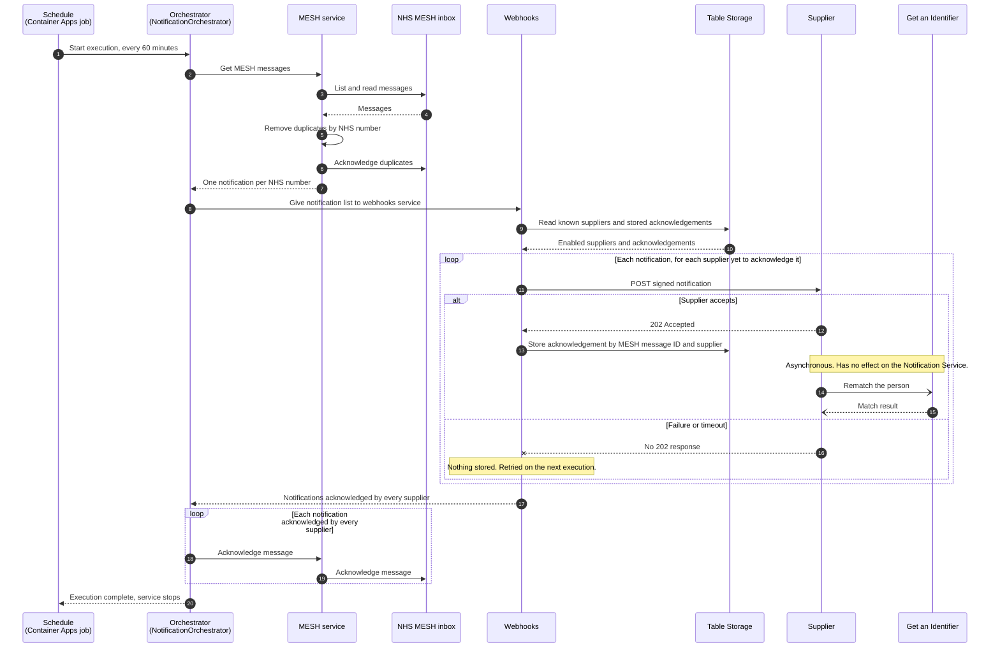

# Notification Service: end-to-end flow

**Date:** `2026-11-06`  
**Owner:** SUI Service Team

> **Status: target architecture, partly implemented.** This page describes the intended final flow, not the current behaviour. See [Implementation status](../../../Apps/NotificationService/README.md#implementation-status) for what exists today.

## The flow in brief

```text
START Notification Service (scheduled, every 60 minutes)

Orchestrator:
    call the MESH service to get the messages

MESH service:
    read all messages in the MESH inbox
    remove duplicates, so there is one message per NHS number
    return the list to the orchestrator

Orchestrator:
    give the list to the webhooks service

Webhooks:
    FOR EACH message in the list
        FOR EACH known supplier that has not yet acknowledged this message
            send the message to the supplier's webhook
            wait for the supplier's response
            IF the supplier acknowledged
                store the acknowledgement against the MESH message ID and supplier
    tell the orchestrator which messages every supplier has acknowledged

Supplier (asynchronous, does not affect the Notification Service):
    after acknowledging, call Get an Identifier to rematch the person

Orchestrator:
    FOR EACH message that every supplier has acknowledged
        ask the MESH service to acknowledge it

MESH service:
    acknowledge the message, which removes it from the MESH inbox

STOP Notification Service
```

Any message that a supplier has not acknowledged stays in the MESH inbox and is picked up by the next execution.

## Sequence diagram



## Key behaviour

- **Run to completion.** The service starts on a schedule, works through what is in the inbox and exits. It is not a poller and it does not stay running between executions. Scheduled executions cannot overlap, because the 30-minute replica timeout is shorter than the 60-minute interval.
- **A supplier acknowledges through its HTTP response.** The service is a job with no inbound endpoint, so suppliers do not call back. An acknowledgement is the empty `202 Accepted` returned to the webhook request, as defined in the [supplier lifecycle webhook contract](../Notifications-Webhooks/SupplierLifecycle/V1/Index.md#acknowledgement-and-idempotency). A `202` means the supplier has durably accepted the event, not that it has finished rematching.
- **Rematching is separate.** Suppliers call Get an Identifier after acknowledging, in their own time. A failed or slow rematch does not affect the Notification Service.
- **The MESH acknowledgement is the last step.** A message leaves the inbox only when every known supplier has acknowledged it, so a failure at any earlier point leaves it to be handled by the next execution. The exception is a duplicate, which is acknowledged early because the message it duplicates stays in the inbox. See [duplicate message handling](./DuplicateHandling.md).
- **Stored acknowledgements stop repeat deliveries.** Acknowledgements are keyed by the message ID from the MESH mailbox, with one record per supplier. When an execution retries a message, only the suppliers with no stored acknowledgement receive it again. Suppliers must still tolerate repeats, because the contract is at-least-once delivery. A retried message can be replaced by a duplicate copy with a different message ID, in which case suppliers that acknowledged the original receive the copy too.
- **The stored acknowledgement must not contain an NHS number.** [ADR 0002](../../architecture/decisions/System/GetAnIdentifier/0002-mns-duplicate-avoidance.md) records the directive not to store NHS numbers, so the record identifies the message and the supplier only.
- **This flow does not yet cover a supplier that never acknowledges.** The message stays in the inbox and is retried on each execution until MESH makes it unavailable, five days after it was sent. That supplier then never receives it.
- **Modules do not call each other.** The webhooks and MESH projects are adapters and neither references the other. Both report to the orchestrator in `SUI.NotificationService.Application`, which decides when a message is acknowledged.

## Open questions

1. **Acknowledgement storage.** Where are acknowledgements stored, and how long are they retained?

## Related

- [Notification Service README](../../../Apps/NotificationService/README.md)
- [Duplicate message handling](./DuplicateHandling.md)
- [Supplier lifecycle webhook contract v1](../Notifications-Webhooks/SupplierLifecycle/V1/Index.md)
