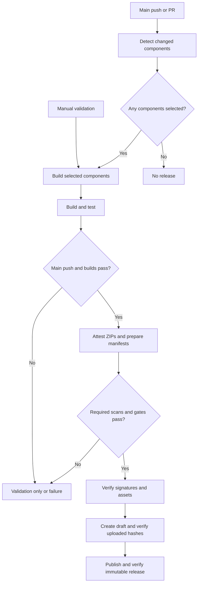

# Immutable application releases

The [CI/CD orchestrator](../../.github/workflows/ci-cd-orchestrator.yml) builds changed AuthEmulator, GetAnIdentifier and UIHarness components and publishes separate immutable GitHub Releases on pushes to protected `main`. PR and manual runs validate without publishing. Manual validation can select all three components using `force_deploy_all`.

The immutable release and ZIP verification workflows are shared across components. Deployment routes are app-specific: Get an Identifier's route is documented below, while UI Harness and Auth Emulator continue to use their per-app workflows. Notification Service container releases are deferred. Application deployment workflows do not apply Terraform.



The selected apps use the pinned SDK and committed NuGet locks, with a locked restore, Release build and publish without rebuilding. Secret, repository and IaC scans and any required helper tests must pass before publication. Shared SDK/NuGet and release-workflow changes select all three components.

The release build authenticates to the DfE NuGet feed through NuGet's source credentials environment variable, leaving `nuget.config` unchanged. Where coverage is enabled, ReportGenerator produces the reports used by SonarCloud and the PR coverage comment.

Each component release contains its tested ZIP, a CycloneDX JSON SBOM named `<ZIP filename>.cdx.json`, and `release-manifest.json`. The manifest records the tag, full source SHA, workflow run ID and attempt, timestamp, component and ZIP filename; `container` is null. New tags use `<component>-YYYY.MM.DD-build.<run number>`, for example `get-an-identifier-2026.11.05-build.1234`. The UTC date and run number stay the same on a rerun; the full source SHA remains in the manifest. Existing releases retain their `sui-<component>-<full source SHA>` tags. Resolve a release ID from its tag. The publisher verifies the ZIP provenance and SBOM attestations against the trusted workflow and source commit, compares the signed SBOM predicate with the release asset, then checks the complete draft asset inventory and SHA-256 hashes before publishing.

## Verifying the SBOM

Download the ZIP and matching `.cdx.json` asset from the component release. Verify the ZIP against the repository, trusted attestation workflow, source SHA and main ref, then compare the verified predicate with the downloaded SBOM:

```bash
gh attestation verify "$ZIP" --repo DFE-Digital/single-unique-identifier \
  --signer-workflow DFE-Digital/single-unique-identifier/.github/workflows/attest-release-zips.yml \
  --source-digest "$SOURCE_SHA" --source-ref refs/heads/main \
  --predicate-type https://cyclonedx.org/bom --format json > verified-sbom.json
jq -e --slurpfile sbom "$ZIP.cdx.json" \
  'any(.[]; .verificationResult.statement.predicate == $sbom[0])' verified-sbom.json
```

Set `ZIP` to the downloaded ZIP path and `SOURCE_SHA` to the full source SHA from `release-manifest.json`. The SBOM is generated with the pinned Trivy version from the extracted deployment ZIP, not from the source tree. It inventories what Trivy can identify in the packaged files; it is not a guarantee that every dependency is detected. CycloneDX and SPDX are both supported by GitHub; CycloneDX was selected for this security-focused inventory. Repository and licence scans remain separate.

## Recovering a publication failure

1. Check the failed job's summary and logs for its stage, component, tag and expected versus observed asset inventory. Resolve the underlying problem before retrying.
2. If only publication failed and the original Actions artifact is still retained, rerun the failed publication job. It reuses the tested ZIP, SBOM and manifest and verifies the attestation again.
3. A draft is replaced only when it targets the expected commit. A published release is reused only after its immutable state, tag, ZIP and SBOM digests and stable manifest fields are checked. Mismatches fail without replacing published releases.
4. Confirm the resulting release is immutable and its tag and assets match the intended commit.

A whole-workflow rerun may regenerate different SBOM bytes or rebuild different ZIP bytes and is not the normal way to recover a publication failure. GitHub reruns use the original workflow version and are available for 30 days after the original run. Actions artifacts must still be retained; the repository's current default is 60 days. A publisher fix merged later does not change an earlier run's workflow code.

## Prerequisite

Release immutability must be enabled under repository **Settings > General > Releases**. The publisher uses `GITHUB_TOKEN` and checks immutability after publication; if the setting is disabled, a mutable release can be created before that check fails. See the [pipeline escalation routes](./ci-workflows.md#pipeline--security-escalation-routes) if a failure needs investigation.

## Immutable release promotion

The shared verification workflow accepts any ZIP component and checks its release manifest, asset integrity and build provenance. The shared deployment workflow currently targets Azure Function Apps. Each app's route defines its environment order, approvals, smoke tests and rollback workflow.

### Get an Identifier route

When `GET_AN_IDENTIFIER_IMMUTABLE_PROMOTION` is enabled, the Get an Identifier matrix job passes its own published release ID to promotion. GitHub deploys to `d01` automatically. Approve `d02` and then `d03` on that same Actions run. Each stage becomes available after the previous stage has deployed, restored SCM access restrictions and passed its smoke tests.

Auth Emulator and UI Harness deploy to Azure Web Apps. Their immutable release verification is already shared; promotion requires a verified Web App deployment workflow and app-specific environment, approval and smoke-test routes. Their existing per-app deployment workflows remain in use until those routes are configured.

The verifier requires a signed provenance subject that binds the exact ZIP digest to its component-prefixed build filename. The trusted build creates that name before attestation. Existing releases with this signed evidence remain eligible for verification. Missing or contradictory evidence fails verification. Each deployment stage downloads the verified ZIP by artefact ID from the same run and checks its digest before deploying. Follow the GitHub deployment job link for the release ID, source SHA, ZIP digest and smoke result.

Approvals can wait up to 30 days and the whole run can last up to 35 days. Retain the verified ZIP artefact for the full run. Deployments and smoke tests share a queue per physical target. GitHub orders the queue by when jobs start waiting, so concurrent builds and delayed approvals can deploy out of commit order.

### Activation prerequisites

Keep `GET_AN_IDENTIFIER_IMMUTABLE_PROMOTION` unset or false until both checks below are implemented and exercised in GitHub against the target environments. Run them after approval and inside the same deployment lock used by promotion and rollback.

- **Promotion ordering.** Record the exact release and source commit before Azure can change the target. Compare commit ancestry against the newest release that may have reached that target, including attempts that failed, were cancelled or failed smoke tests. Permit a retry of the same release and preserve the ordering record across an approved rollback. Block on unknown or contradictory target history.
- **Rollback eligibility.** Require positive evidence that the exact release and digest finished deployment, cleanup and smoke tests successfully against the physical target. Treat `get-an-identifier-d01` and `get-an-identifier-d01-rollback` as the same target. Retain the reviewer checks below.

Evaluate GitHub deployment records with an explicit payload for the release ID, digest, source SHA and target. Native Environment deployments identify the workflow run ref, which on rollback is the dispatch commit. An Environment approval or record alone does not establish which bytes reached Azure. GitHub expires deployment statuses after 90 days, so establish how to handle missing history before activation.

### Set up and cut over

1. Create GitHub Environments `get-an-identifier-d01`, `get-an-identifier-d02`, `get-an-identifier-d03` and `get-an-identifier-d01-rollback`. Allow only the `main` branch. In `d02`, `d03` and `d01` rollback, configure required reviewers, enable **Prevent self-review** and disable admin bypass.
2. In each Environment, set the `PROMOTION_FUNCTION_APP_NAME` and `PROMOTION_FUNCTION_APP_RESOURCE_GROUP` variables and the `PROMOTION_AZURE_CLIENT_ID`, `PROMOTION_AZURE_TENANT_ID` and `PROMOTION_AZURE_SUBSCRIPTION_ID` secrets. Use a federated identity bound to that repository and Environment. Scope it to the target Function App and verify that it can deploy and manage SCM access restrictions. Copy the target's smoke secrets into `PROMOTION_SMOKE_TEST_BASE_URL`, `PROMOTION_SMOKE_TEST_TOKEN_URL`, `PROMOTION_SMOKE_TEST_CLIENT_IDS_JSON_MAP` and `PROMOTION_SMOKE_TEST_CLIENT_SECRETS_JSON_MAP`, plus `PROMOTION_SMOKE_TEST_AUTH_SCOPE` for `d02` and `d03`. Both `d01` Environments must point to the same Function App and smoke endpoints.
3. Verify branch policies, reviewers, identity assignments, runner connectivity and smoke configuration. Before activation, drain legacy Get an Identifier deploys and remove or constrain their Azure deployment access so an older workflow revision cannot deploy the app. Coordinate any changes to shared identities with the infrastructure workflow owners. Set the repository variable `GET_AN_IDENTIFIER_IMMUTABLE_PROMOTION` to `true` at the approved cutover. Current workflow revisions then disable legacy Get an Identifier deploys and the standalone Function App artifact dispatch.
4. Verify automatic `d01` on the next normal release, then approve `d02` and `d03` on the same run. Check the deployment record and smoke result in each Environment.

### Roll back

Run **Roll back Get an Identifier release** from `main` with the target and numeric release ID. Find the ID with `gh release view <tag> --json databaseId --jq .databaseId`. Before approving, the reviewer must confirm in GitHub deployment history that the exact release previously deployed and passed smoke tests in the target. For `d01`, both the normal and rollback Environment histories refer to the same target. Add a link to the successful job in the approval comment. Review queued and pending promotions for the target so a later approval does not unintentionally override the rollback.

Rollback verifies the immutable ZIP again and runs fresh smoke tests. Deploying a rollback does not reverse infrastructure or configuration.

### SCM cleanup and recovery

Function App cleanup attempts to disable public network access and remove the temporary SCM allow rule independently. The job fails if cleanup cannot confirm both that public network access is disabled and that the rule is absent. A deployment can recover interrupted SCM access when a reserved `github-deploy-<run ID>-<attempt>` rule remains. Cleanup can remove that rule even if disabling public access fails. If public access is enabled without the rule, deployment stops. Disable public access manually and verify the temporary SCM rule is absent before retrying.
