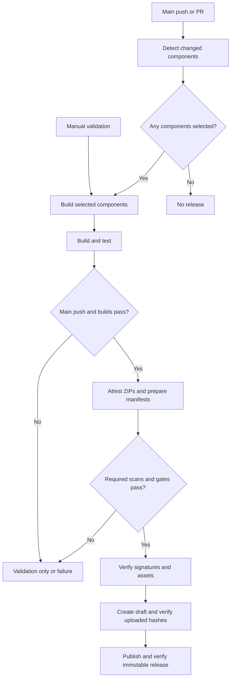

# Immutable application releases

The [CI/CD orchestrator](../../.github/workflows/ci-cd-orchestrator.yml) builds changed AuthEmulator, GetAnIdentifier and UIHarness components and publishes separate immutable GitHub Releases on pushes to protected `main`. PR and manual runs validate without publishing. Manual validation can select all three components using `force_deploy_all`.

The [per-app workflows](./ci-workflows.md) remain the operational build-and-deploy route. They build separately and deploy GitHub Actions artifacts. Promotion and deployment from immutable releases are follow-up work. Notification Service container releases are deferred. The release orchestrator does not deploy applications or apply Terraform.



The selected apps use the pinned SDK and committed NuGet locks, with a locked restore, Release build and publish without rebuilding. Secret, repository and IaC scans and any required helper tests must pass before publication. Shared SDK/NuGet and release-workflow changes select all three components.

Each component release contains its tested ZIP, a CycloneDX JSON SBOM named `<ZIP filename>.cdx.json`, and `release-manifest.json`. The manifest records the tag, full source SHA, workflow run ID and attempt, timestamp, component and ZIP filename; `container` is null. New tags use `<component>-YYYY.MM.DD-build.<run number>`, for example `get-an-identifier-2026.11.05-build.1234`. The UTC date and run number stay the same on a rerun; the full source SHA remains in the manifest. Existing releases retain their `sui-<component>-<full source SHA>` tags. Resolve a release ID from its tag. The publisher verifies the ZIP provenance and SBOM attestations against the trusted workflow and source commit, compares the signed SBOM predicate with the release asset, then checks the complete draft asset inventory and SHA-256 hashes before publishing.

## Verifying the SBOM

Download the ZIP and matching `.cdx.json` asset from the component release. Verify the ZIP against the repository, trusted attestation workflow, source SHA and main ref, then compare the verified predicate with the downloaded SBOM:

```bash
gh attestation verify "$ZIP" --repo DFE-Digital/single-unique-identifier \
  --signer-workflow DFE-Digital/single-unique-identifier/.github/workflows/attest-release-zips.yml \
  --source-digest "$SOURCE_SHA" --source-ref refs/heads/main \
  --predicate-type https://cyclonedx.org/bom --format json > verified-sbom.json
jq -e --slurpfile sbom "$ZIP.cdx.json" \
  'any(.[]; .verificationResult.statement.predicate == $sbom[0])' verified-sbom.json
```

Set `ZIP` to the downloaded ZIP path and `SOURCE_SHA` to the full source SHA from `release-manifest.json`. The SBOM is generated with the pinned Trivy version from the extracted deployment ZIP, not from the source tree. It inventories what Trivy can identify in the packaged files; it is not a guarantee that every dependency is detected. CycloneDX and SPDX are both supported by GitHub; CycloneDX was selected for this security-focused inventory. Repository and licence scans remain separate.

## Recovering a publication failure

1. Check the failed job's summary and logs for its stage, component, tag and expected versus observed asset inventory. Resolve the underlying problem before retrying.
2. If only publication failed and the original Actions artifact is still retained, rerun the failed publication job. It reuses the tested ZIP, SBOM and manifest and verifies the attestation again.
3. A draft is replaced only when it targets the expected commit. A published release is reused only after its immutable state, tag, ZIP and SBOM digests and stable manifest fields are checked. Mismatches fail without replacing published releases.
4. Confirm the resulting release is immutable and its tag and assets match the intended commit.

A whole-workflow rerun may regenerate different SBOM bytes or rebuild different ZIP bytes and is not the normal way to recover a publication failure. GitHub reruns use the original workflow version and are available for 30 days after the original run. Actions artifacts must still be retained; the repository's current default is 60 days. A publisher fix merged later does not change an earlier run's workflow code.

## Prerequisite

Release immutability must be enabled under repository **Settings > General > Releases**. The publisher uses `GITHUB_TOKEN` and checks immutability after publication; if the setting is disabled, a mutable release can be created before that check fails. See the [pipeline escalation routes](./ci-workflows.md#pipeline--security-escalation-routes) if a failure needs investigation.
